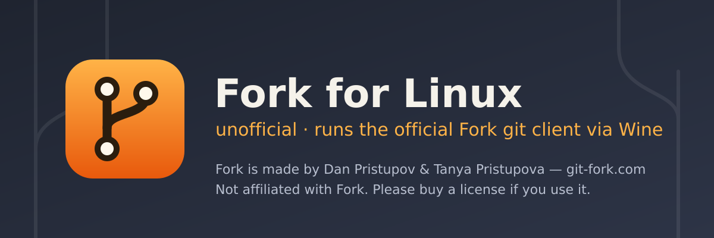

<p align="center">
	<a href="https://github.com/ventura8/Fork-Linux/releases/latest">
		
	</a>
	<a href="https://github.com/ventura8/Fork-Linux/releases">
		
	</a>
	<a href="https://github.com/ventura8/Fork-Linux/actions/workflows/check.yml?query=branch%3Amain">
		
	</a>
	<a href="LICENSE">
		
	</a>
</p>

Run the official **[Fork](https://git-fork.com) git client for Windows** on Linux — installed, launched, integrated and updated for you under Wine, without modifying Fork.

> [!IMPORTANT]
> **Fork for Linux (unofficial)** is a community project. It is **not affiliated with, endorsed by, or supported by** Fork's developers, Dan Pristupov and Tanya Pristupova.
>
> - Fork is **proprietary, paid software**. The evaluation is free; if you keep using it, please **[buy a license](https://git-fork.com/buy)**.
> - This project never redistributes or patches Fork: the official installer is downloaded from `cdn.fork.dev` on your machine and verified.
> - **Report wrapper bugs here**, in [this repository's issues](https://github.com/ventura8/Fork-Linux/issues) — not to Fork support.

## How it works

1. `fork-linux` (Python 3.10+, standard library only) creates a **private Wine prefix** in `~/.local/share/fork-linux/prefix/`. It never touches `~/.wine` or any prefix it did not create.
2. On first run it downloads a **pinned, sha256-verified Wine** build, installs **.NET Framework 4.8** and the core fonts with winetricks, applies the registry tweaks Fork needs, then runs the **official Fork installer** silently.
3. Every launch goes straight to Wine (`fork ~/src/repo` opens the repository). Before each launch, a snapshot of Fork's install lets you **roll back** a bad Fork self-update.
4. Small Windows shims let Fork open your **Linux terminal, file manager and diff tools**, and a relay lets Fork's ssh use your **ssh-agent**. An experimental, opt-in **git bridge** makes Fork run your native `/usr/bin/git`.

## Quick install

Per-user install into `~/.local` (no `sudo`; it asks before installing any missing host libraries with your package manager):

```bash
curl -fsSL https://github.com/ventura8/Fork-Linux/releases/latest/download/install.sh | bash
```

Prefer to read it first? Download, inspect, then run:

```bash
curl -fsSLO https://github.com/ventura8/Fork-Linux/releases/latest/download/install.sh
less install.sh
bash install.sh            # --help lists --system, --setup, --dry-run, --version, ...
```

The installer verifies the release tarball against `SHA256SUMS` and keeps a manifest so `uninstall.sh` removes exactly what it installed. With `--from-tarball FILE`, a checksum mismatch stops the install and leaves your file where it is.

## Install methods

All channels are **x86_64 only** and never depend on your distribution's `wine` package. The packages and the installer script are on the [GitHub Release](https://github.com/ventura8/Fork-Linux/releases); Ubuntu and Mint can use the PPA.

| Channel | Command |
|---|---|
| Ubuntu / Mint (PPA: 22.04, 24.04, 26.04) | `sudo add-apt-repository ppa:ventura8/fork-linux && sudo apt install fork-linux` |
| Debian / Ubuntu `.deb` | Download from [Releases](https://github.com/ventura8/Fork-Linux/releases), then `sudo apt install ./fork-linux_<version>_amd64.deb` |
| Fedora 44 | `sudo dnf install ./fork-linux-<version>-1.fc44.x86_64.rpm` |
| openSUSE Leap 16.0 | `sudo zypper install ./fork-linux-<version>-*.x86_64.rpm` |
| Flatpak | `flatpak install --user ./io.github.ventura8.ForkLinux-<version>-x86_64.flatpak` (uses the `org.winehq.Wine` BaseApp) |
| AppImage | `chmod +x fork-linux-<version>-x86_64.AppImage && ./fork-linux-<version>-x86_64.AppImage --install-desktop` |
| Tarball | `fork-linux-<version>-x86_64.tar.gz` — relocatable; `install.sh --from-tarball` installs it |

**Coming later:** the AUR (`fork-linux`) and the Snap Store. Until then, on Arch Linux use `install.sh`, the AppImage or the Flatpak.

## First run

Start **Fork for Linux (unofficial)** from your app menu, or run `fork`. Setup shows Fork's [license agreement](https://git-fork.com/license) and the download list, and asks before it starts. Then it fetches:

| What | From | Size |
|---|---|---|
| Wine 11.18 staging (WoW64) — Kron4ek build, pinned + sha256-verified | GitHub ([Kron4ek/Wine-Builds](https://github.com/Kron4ek/Wine-Builds)) | ~101 MB |
| Winetricks (pinned release) | GitHub ([Winetricks/winetricks](https://github.com/Winetricks/winetricks)) | < 1 MB |
| Microsoft .NET Framework 4.8 and core fonts — installed by winetricks under **Microsoft's license terms** | Microsoft | ~125 MB |
| Selawik 1.01 interface font (Microsoft's open-source Segoe UI stand-in, SIL OFL 1.1), pinned + sha256-verified | GitHub ([microsoft/Selawik](https://github.com/microsoft/Selawik)) | < 1 MB |
| Fork installer (2.23.2 by default), verified against a pinned sha256 | `https://cdn.fork.dev/win/` | ~76 MB |

Plan for **about 2.5–3 GB of disk** and **10–20 minutes** (less on a fast connection). Setup is resumable: if it fails, the next run continues from the failed step. Headless: `fork-linux setup --accept-fork-eula --no-launch`.

Downloads are cached in `~/.cache/fork-linux/` (winetricks' .NET and font downloads in `~/.cache/fork-linux/winetricks/`, so `uninstall --purge` removes them too). Files already in winetricks' own `~/.cache/winetricks/` are reused, and that folder is never changed. Fork's default folder for new clones is your Linux home from the very first start.

## Usage

- `fork` — start Fork.
- `fork .` or `fork ~/src/myrepo` — open a repository (a path inside a repository opens its root). If Fork is already running, the repository opens in a new tab.
- **Desktop launcher** — "Fork for Linux (unofficial)" in your app menu, with Fork's own icon extracted from your copy (at every icon size; a neutral placeholder until Fork is installed). On Cinnamon and MATE the menu picks up a brand-new `~/.local/share/applications` only at the next login; fork-linux says so when it had to create that folder.
- **Open in Fork** — a right-click action in Nautilus, Nemo, Caja, Dolphin, Thunar and PCManFM-Qt. `install.sh` and `fork-linux desktop install` add it for the file managers installed on your computer (`--file-managers auto`, the default); `--file-managers all` or a list such as `thunar,nemo` picks them yourself. In Thunar the action is added next to your desktop's own custom actions ("Open Terminal Here", ...), and removing it brings back exactly what was there.

## Updating

**Fork updates itself, in the app.** When Fork says a new version is available (or after **File > Check for Updates...**), click **Restart and Update**: Fork's own updater downloads the new version, replaces its install and restarts Fork — this works under Wine, also with the git bridge on ([spike S9](docs/spikes/S9-fork-self-update.md)). Fork's update channel is its own setting (Preferences > Updates): *Develop* (Fork's default) gets every release; *Stable* lags well behind.

- **Before every launch** fork-linux keeps a snapshot of the installed Fork (the newest two are kept), and the first start after an update tells you about it. If a new version misbehaves under Wine, close Fork and run `fork-linux rollback` (or `fork-linux rollback --to-version 2.23.2`). A rollback **pins** that version: fork-linux turns Fork's own update check off until you run `fork-linux config set fork.update_policy auto`, which turns it back on with your previous channel. `fork-linux snapshot list` shows what you can go back to.
- `fork-linux update --check` shows the installed, tested and newest Fork versions and Fork's update channel; `fork-linux update --fork` reinstalls the tested version from Fork's CDN (`--latest` for the newest). It downloads first and snapshots the installed version before it changes anything; a `--latest` install whose package does not match Fork's update feed is undone at once.
- While Fork's **Restart and Update** runs, `fork <path>` waits for the restarted Fork and opens the path there; `update`, `rollback` and `setup` ask you to wait.
- **fork-linux itself** (this wrapper) is updated by whatever installed it: your package manager (`apt`, `dnf`, `zypper`, `flatpak update`), re-running `install.sh` for a per-user install, or the AppImage's zsync update information (e.g. `appimageupdatetool`). The next launch re-runs only the setup steps the new release changed (nothing is downloaded again unless the pinned Wine changed; the previous Wine build is kept). `fork-linux update --wine` moves to the Wine runtime a new fork-linux release pins. Going back to an older fork-linux works too; it warns once.

## CLI

`fork-linux [--json] [--prefix DIR] [--gui | --no-gui] [--offline] [-v | -q] [--allow-root] <command>` — `fork-linux --help` and `man fork-linux` list every option.

| Command | Purpose |
|---|---|
| `setup [--fork-version V \| --latest] [--allow-untested] [--wine managed\|system\|flatpak\|PATH] [--dotnet auto\|dotnet48\|dotnet472] [--accept-fork-eula] [--only STEP \| --from-step STEP] [--force] [--reset] [--no-launch] [--list-steps]` | Idempotent, resumable bootstrap |
| `run [PATH …]`, `open PATH …`, `fork [PATH]` (`[--debug] [--wine-debug CHANNELS] [--x11 \| --wayland] [--no-setup] [--no-hooks] [--restart] [--from-file-manager]`) | Launch Fork or open repositories; `fork` takes the global options and these |
| `update [--check \| --fork \| --wine] [--fork-version V \| --latest] [--allow-untested]` | Check for and apply Fork / Wine runtime updates |
| `snapshot create [--reason R] \| list \| delete ID \| prune` | Manage snapshots of Fork's install |
| `rollback [ID \| --to-version V] [--with-settings] [--no-pin]` | Restore a snapshot and pin that version |
| `doctor [--fix] [--deep] [--network] [--check ID …]` | 52 health checks with fix hints |
| `config get \| set \| unset \| list \| path \| edit` | Fork for Linux settings (`~/.config/fork-linux/config.ini`) |
| `settings show \| get KEY \| set [--string] KEY VALUE \| unset KEY \| apply-defaults \| backup \| restore [FILE] \| path` | Fork's own `settings.json` (edited only while Fork is closed) |
| `desktop install [--file-managers LIST] [--no-menu] [--no-icons] [--cli-alias] \| remove \| status` | Menu entry, icon, file-manager actions |
| `ssh sync [--dry-run] [--mode link\|copy] [--no-config] \| status` | Share your SSH keys and config with Fork |
| `git-bridge enable [--build] \| disable \| status \| record on\|off` | Experimental native-git bridge (opt-in; `--build` builds the shims in a source checkout; `record` forwards to bundled git for debugging) |
| `repo check [PATH …] \| fix [--yes] [--no-filemode] [--no-symlinks] PATH … \| undo PATH …` | Check a repository's settings for Fork under Wine, fix them on request, and undo exactly that fix |
| `logs [--wine \| --fork \| --velopack \| --setup \| --all] [--follow \| --path \| --bundle]` | Show logs or create a redacted bug-report bundle |
| `uninstall [--purge] [--keep-downloads] [--yes]` | Remove integrations; `--purge` also removes the prefix (with every other prefix in `~/.local/share/fork-linux/`), runtimes and caches (`--keep-downloads` keeps the downloaded Wine, Fork, .NET and fonts) |
| `about` / `credits`, `version`, `status` | Credits, version, setup and Fork status |

Exit codes are stable and documented in [AGENTS.md §5](AGENTS.md#5-standard-exit-code-mapping) (for example `10` not set up, `13` integrity check failed, `15` Fork is running).

## Wine providers

| Provider | What it uses |
|---|---|
| `managed` (default) | A pinned Kron4ek Wine 11.18 staging WoW64 build, downloaded and sha256-verified per user. No i386 multiarch needed. Kron4ek 11.0 staging is also available (`fork-linux config set wine.build kron4ek-11.0-staging-wow64`). |
| `system` | Your distribution's Wine ≥ 9.0. Non-staging builds trigger a warning: git hooks and bash-based features need staging ([Wine bug 55138](https://bugs.winehq.org/show_bug.cgi?id=55138)). |
| `flatpak` | The Wine from the `org.winehq.Wine` BaseApp (Flatpak builds only). |
| custom path | `fork-linux setup --wine /path/to/bin/wine` |

## Git bridge (experimental, opt-in)

By default Fork uses its bundled Git for Windows, which runs under Wine. The git bridge makes Fork's `git.exe`, `bash.exe` and `sh.exe` calls run with your Linux `git` and `/bin/sh` instead, outside Wine:

```sh
fork-linux git-bridge enable     # needs git 2.40 or newer (2.50+ recommended); restart Fork
fork-linux git-bridge status     # enabled / ready / Linux git version / running daemon
fork-linux git-bridge disable    # back to Fork's bundled git at the next start
```

What it changes, verified with Fork 2.23.2:

- **Hooks run natively**: a `pre-commit` hook that fails now blocks the commit and Fork shows its output (bundled git skips such hooks and commits anyway). **Submodule update**, pushes and fetches to `file://` / `/home/…` remotes, interactive rebase from Fork's dialog and **Git Flow** (with `git-flow` installed) work; commits keep exec bits and symlinks.
- **Open in Shell / Console** and **Diff in Linux (fork-linux)** (Ctrl+D on a changed file) open your Linux terminal and diff tool (meld, kdiff3, Beyond Compare or VS Code), and Fork waits for the diff tool.
- **ssh and HTTPS** use your Linux ssh (with your ssh-agent; a key's passphrase is asked in Fork's own prompt) and your Linux credential helpers; without a helper, Fork's prompt asks for the user name and password.
- Each git call is much faster (about 13 ms against about 90 ms for bundled git).

How it works: when Fork starts, fork-linux starts a small helper (`fl-bridge-helper`) outside Wine and points Fork at its own shims in `C:\fork-linux\gitInstance`. The helper lives as long as Fork does — also across Fork's own "Restart and Update" — and stops a few seconds after Fork closes. Only the `[git] bridge` setting and Fork's terminal / diff / merge tool entries change; your `~/.gitconfig` (and its credential helpers, signing and editors) is what git uses.

Limits: Fork's own **Local Changes** list still shows executable files and symlinks as modified (Fork computes it inside Wine; the diff is empty and nothing gets committed). Built from source, the bridge needs `scripts/build-bridge.sh` first (`git-bridge enable` offers to run it). Details: [bridge/README.md](bridge/README.md).

## Compatibility

Baseline: **Ubuntu 26.04**; oldest supported: **Ubuntu 22.04**. CI also covers Ubuntu 24.04, Debian 13, Fedora 44, openSUSE Leap 16.0 and Arch Linux. Results per distribution, desktop and Wine provider are recorded — from real end-to-end runs only — in [docs/COMPATIBILITY.md](docs/COMPATIBILITY.md).

## Troubleshooting

- **Start with `fork-linux doctor`.** It checks the host, Wine, the prefix, Fork and the integrations, and prints a fix for every failure; `fork-linux doctor --fix` applies the safe ones.
- **Logs**: `fork-linux logs` (files in `~/.local/state/fork-linux/logs/`). `fork-linux logs --bundle` creates a redacted archive to attach to an issue. Earlier Fork sessions' `fork.log` files are kept there as `fork-<time>.log`.
- **A terminal or app Fork opens crashes or does not start** (Tilix, Nemo, Snap apps): `fork-linux doctor --check desktop.handoff` says how Fork's terminals and apps leave Wine's process tree on your system (your systemd user session, fork-linux's own launcher daemon, or `flatpak-spawn --host`) and warns when the last one ran inside it; start Fork with `fork-linux run` or the menu entry so the launcher can start its daemon.
- **Fork shows no window or stopped responding**: while Fork runs, `fork-linux run` only hands the paths to it. `fork-linux run --restart` ends the running Fork (everything in its Wine prefix) and starts it again.
- **Fork asks for a key's passphrase although the key is in your ssh-agent**: `fork-linux doctor --check ssh.agent` says why. The relay starts with Fork, from the session's `$SSH_AUTH_SOCK`: after `ssh-add` in a session where Fork was started without an agent, close Fork and start it again (`fork-linux run --restart`). It stays off with `[ssh] agent_relay = off`, without `fl-bridge-helper` (a source checkout needs `scripts/build-bridge.sh`) and when the prefix's file system has no extended attributes (the daemon's `bridge-*.log` in `fork-linux logs --path` names the reason). With `ssh-add -c` the agent asks you to confirm each use, as for Linux ssh.
- **Repository problems**: `fork-linux repo check` lists what breaks per repository (hooks, symlinks, submodules, remotes given as Linux paths, `core.filemode`); `fork-linux repo fix PATH` sets `core.filemode=false` and marks tracked symlinks `skip-worktree` after asking, and `fork-linux repo undo PATH` reverts exactly that.

What fork-linux connects for you:

- **Open in Shell / the Console button** opens your desktop's terminal in the repository (`fork-linux-terminal`; `$FORK_LINUX_TERMINAL` or `[integration] terminal` picks the program, else the terminal your desktop's settings name on Cinnamon and Budgie, else `xdg-terminal-exec` and the desktop's own terminal).
- **Show in File Explorer / Open In File Explorer** opens your Linux file manager with the file selected (or on the folder); **Open** on a file uses your Linux default application.
- **Theme and scale**: Fork starts in your desktop's light or dark theme and at its display scale (GNOME, KDE Plasma, Cinnamon, MATE, Budgie, XFCE and LXQt each asked in their own terms). When the desktop's theme cannot be read, Fork's own "follow system theme" setting is turned back on.
- **File dialogs** (Open repository, Clone, Save as Patch, …) use your Linux file picker by default (`zenity` or `kdialog`; `[integration] system_file_dialogs = on`). Turn that off to get Wine's dialogs again (`fork-linux config set integration.system_file_dialogs off`); with Wine's dialogs, type `H:\src` (the `H:` drive is your home) or `Z:\home\you\src`, not a bare `/home/…` path.
- New clones go to your Linux home by default, never into the Wine prefix.
- **ssh keys and your ssh-agent**: your `~/.ssh` keys, `known_hosts` and a translated `config` are shared with Fork's bundled ssh (`fork-linux ssh sync`, also before each launch). While Fork runs, the launcher **relays your ssh-agent** (`$SSH_AUTH_SOCK`) to Fork's bundled ssh, so a key you added with `ssh-add` is used without a passphrase prompt (`[ssh] agent_relay = on`, the default). Without an agent, Fork asks for a key's passphrase in its own prompt at every fetch and push; `fork-linux ssh sync` and `fork-linux doctor` name such keys. `fork-linux doctor --check ssh.agent` says whether the relay serves your agent. Any Windows program running in Fork's prefix can use the agent while Fork runs (it can already read your files): `fork-linux config set ssh.agent_relay off` turns the relay off. The relay needs a file system with extended attributes for the prefix (ext4, btrfs, xfs, ZFS; tmpfs from Linux 6.6) and only reaches the agent named by `$SSH_AUTH_SOCK` (an `IdentityAgent` in `~/.ssh/config` is commented out for Fork).
- **Non-Latin text** (Cyrillic, Greek, Chinese, Japanese, Korean, ...) in repository names, branches and commit messages uses your Linux fonts: setup points WPF's font fallback at the installed Noto fonts (or DejaVu / Liberation). The deb, rpm and Arch packages recommend the Noto fonts (core + CJK). If such text shows as boxes or not at all, install them (Debian / Ubuntu: `fonts-noto-core fonts-noto-cjk`; Fedora / openSUSE: `google-noto-sans-fonts google-noto-sans-cjk-fonts`; Arch: `noto-fonts noto-fonts-cjk`) and run `fork-linux doctor --fix`.

Known Wine limitations:

- **Hooks that start other programs are silently skipped** by Fork's bundled git under Wine (its `sh` dies after the first program, and the commit still succeeds). `fork-linux doctor` lists affected repositories; commit there from a terminal, or enable the git bridge (see [Git bridge](#git-bridge-experimental-opt-in)), which runs them with Linux git.
- **Git LFS**: *Initialize* and commits work with Fork's bundled git, but a push runs LFS's pre-push hook through that same `sh`, which now and then hangs under Wine (the push never ends). Enable the git bridge for LFS repositories: Linux git (with your distribution's `git-lfs`) runs the hook. On a busy machine Fork's *Local Changes* can stay empty right after *Initialize* (Refresh does not help): close the repository's tab and open it again.
- **Symlinks** look like modified files to Fork (and committing them through Fork's git turns them into plain files); **submodule update / init** does nothing; **Git Bash** exits at once. Use a terminal for these; the git bridge fixes submodules and symlink-preserving commits.
- **Git Flow**: *Initialize* works, but *Start Feature* (git-flow's shell scripts) silently does nothing with Fork's bundled git. With the git bridge it runs with your Linux git: install your distribution's `git-flow` package.
- **Spell checking** does nothing under Wine; keep it disabled.
- **Now and then a pane shows `Win32Exception ... StartWithCreateProcess`** instead of a diff, or an action (applying a stash, for example) ends in a *Git Error* that shows it (Git Flow commands show `OS Error 731` instead): Wine failed to start one of Fork's git processes, so that git call did not run. Select the commit or file again (or press F5), or close the report and repeat the action. It happens most on busy repositories; to avoid it there, enable the experimental [git bridge](#git-bridge-experimental-opt-in) (`fork-linux git-bridge enable`), which runs Fork's git calls with your Linux git outside Wine. When it is the last step of *Initialize Git Flow* (`git config gitflow.path.hooks`), Git Flow is already set up: just close the report.
- **GitHub account sign-in (OAuth) can crash Fork under Wine.** Use a GitHub personal access token instead. For HTTPS remotes Fork's git uses Git Credential Manager: it asks once for the user name and password (or token) and keeps them with DPAPI inside the prefix. When its window cannot open under Wine (now and then on the first prompt after Fork starts), Fork's own prompt asks instead, and the account is kept just the same.
- **Copy Path / Copy Full Path** in Fork put the path Fork sees on your clipboard: a full path is a Windows path such as `Z:\home\you\src\file.txt`. A repository opened by typing `H:\...` stays under `H:` in Fork's tab list; fork-linux's `repo check` and `doctor` find it all the same.
- **Wayland**: Fork runs through XWayland by default; Wine's native Wayland driver is opt-in and experimental.
- **License activations**: each new Wine prefix may count as a new machine for your Fork license (3 per license). **Deactivate the license in Fork before `fork-linux uninstall --purge`** or before deleting the prefix.

## Uninstall

```bash
fork-linux uninstall            # remove menu entries, icons and file-manager actions; keep your prefix
fork-linux uninstall --purge    # also delete the prefix, runtimes, snapshots and caches (deactivate your license first)
```

Then remove the program with the tool you installed it with: `curl -fsSL https://github.com/ventura8/Fork-Linux/releases/latest/download/uninstall.sh | bash` (for `install.sh` installs), `sudo apt remove fork-linux`, `sudo dnf remove fork-linux`, `sudo zypper remove fork-linux`, `flatpak uninstall io.github.ventura8.ForkLinux`, or delete the AppImage. Packages never touch your home directory, and nothing ever touches `~/.wine`.

## Credits & support the developers

<!-- credits:begin -->
**Fork** is made by **Dan Pristupov** and **Tanya Pristupova** — https://git-fork.com. Everything that makes Fork great is their work; this wrapper only makes it start on Linux.

- **Please buy a license:** https://git-fork.com/buy — the evaluation is free; a license ($59.99 at the time of writing) covers one user on up to three machines.
- Release notes: https://git-fork.com/releasenoteswin · License (EULA): https://git-fork.com/license · Twitter: [@git_fork](https://twitter.com/git_fork)
- Fork's issue trackers: [fork-dev/TrackerWin](https://github.com/fork-dev/TrackerWin) (Windows) · [fork-dev/Tracker](https://github.com/fork-dev/Tracker) (Mac and general). support@fork.dev is for licensing questions only.

> Fork for Linux (unofficial) is **NOT affiliated with, endorsed by, or supported by** Fork's developers. Report Linux and wrapper issues to [ventura8/Fork-Linux](https://github.com/ventura8/Fork-Linux/issues), not to Fork support. If a problem also happens on Windows, report it to [fork-dev/TrackerWin](https://github.com/fork-dev/TrackerWin).

**Community prior art:** [pixiekat's Wine guide (§10)](https://github.com/pixiekat/gists/blob/main/install-wine-and-delinea.md), [jasonnicholson/fork-wine-setup](https://github.com/jasonnicholson/fork-wine-setup), [NitroHxC's gists](https://gist.github.com/NitroHxC/ff579d57b15f7ba5dcd1429eac13468f), [fork-dev/Tracker#2033](https://github.com/fork-dev/Tracker/issues/2033) and [#153](https://github.com/fork-dev/Tracker/issues/153), the [WineHQ AppDB](https://appdb.winehq.org/objectManager.php?sClass=version&iId=42350), [dakusan/tortoisewine](https://github.com/dakusan/tortoisewine), [coskunergan/ubuntu_tortoise](https://github.com/coskunergan/ubuntu_tortoise), [andy-5/wslgit](https://github.com/andy-5/wslgit).

**Upstream projects:** [Wine](https://www.winehq.org), [Kron4ek Wine-Builds](https://github.com/Kron4ek/Wine-Builds), [Winetricks](https://github.com/Winetricks/winetricks), [Selawik](https://github.com/microsoft/Selawik), [Noto fonts](https://notofonts.github.io).

Full credits and third-party licenses: [docs/CREDITS.md](docs/CREDITS.md).
<!-- credits:end -->

## Contributing

Issues and pull requests are welcome — please use the [issue forms](https://github.com/ventura8/Fork-Linux/issues/new/choose) and the [pull request template](.github/pull_request_template.md). Before you start, read [AGENTS.md](AGENTS.md): its hard rules apply to every contributor, human or AI. In short:

- never add Fork binaries, logos, icons or screenshots, and never patch Fork;
- every download is HTTPS and sha256-verified;
- never touch `~/.wine` or a prefix we did not create;
- Python 3.10 standard library only, no linter suppressions, tests for new code.

## AI Assistance

If you are developing or modifying this codebase using an AI coding assistant, start from the canonical rules and skills:

* [AGENTS.md](AGENTS.md) — Workspace guidelines, hard rules, architecture summary, coding standards, CI/Docker matrix rules (shared across tools).
* [docs/INSTRUCTIONS.md](docs/INSTRUCTIONS.md) — Build, install, extend, and debug.
* [docs/architecture/README.md](docs/architecture/README.md) — Component deep dive.
* [`.agents/skills/`](.agents/skills/) — Focused runbooks (`SKILL.md` per workflow).

Thin tool entrypoints (point at `AGENTS.md`, do not fork rules): [CLAUDE.md](CLAUDE.md), [GEMINI.md](GEMINI.md), [`.github/copilot-instructions.md`](.github/copilot-instructions.md), [`.cursor/rules/fork-linux-agents.mdc`](.cursor/rules/fork-linux-agents.mdc). Legacy stubs: [agent.md](agent.md), [skills.md](skills.md).

## License

The code in this repository is released under the [MIT License](LICENSE). **Fork itself is proprietary software** owned by its developers and licensed under [its own terms](https://git-fork.com/license); it is not covered by this license and is never included in this repository or its packages. "Fork" and the Fork logo are trademarks of their respective owners; all other trademarks belong to their respective owners.
